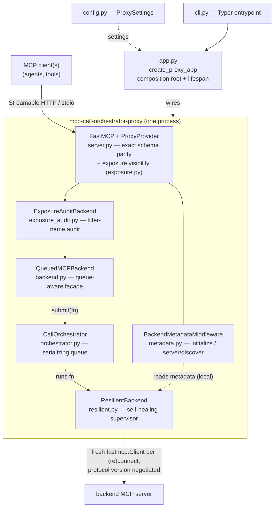

# Architecture

## Purpose / scope

The proxy makes a single, possibly-fragile backend MCP server safe for multiple
concurrent MCP clients. It does three things and nothing more:

1. **Session termination** — the proxy is the backend's only client. Every client's requests
   end at the proxy, under whichever protocol version the client speaks, and the backend sees
   one connection: the proxy's own. Clients never share a session or a connection with the
   backend, so one client cannot corrupt or race another's state there.
2. **Call serialization** — every operation forwarded to the backend passes through a
   single queue with a configurable concurrency limit (default `1` = fully serialized).
3. **Resilience** — the proxy stays connectable even when the backend is absent, and
   reconnects on its own when the backend comes and goes.

To the client it looks like the backend itself: the proxy mirrors the backend's tools,
resources, and prompts with their **exact original JSON schemas** (no lossy wrapper), plus
one added `backend_status` tool.

## Design invariants

These are load-bearing; changing any of them changes the product.

- **Exact tool/schema parity.** The proxy exposes the backend's tools/resources/prompts
  under their real names and schemas. Achieved by delegating to FastMCP's own
  `ProxyProvider` rather than re-declaring tools. Nothing to hand-sync. The server is
  built with `dereference_schemas=False`: FastMCP otherwise inlines every `$ref` and drops
  `$defs` on listing, which keeps the accepted inputs but changes the schema's structure.
- **Exactly one backend.** A backend config that does not define exactly one server is
  refused at startup (`client.py::check_backend_config`, called by `create_proxy_app`) — a
  composite mount would prefix every tool name (`{server}_{tool}`) and break parity.
  `client.py::_single_server_transport` applies the same check on each connect.
- **Serialize by default.** `max_concurrent_calls` defaults to `1`. This is the whole
  reason the project exists; raising it is opt-in.
- **Stay connectable, degrade.** The proxy must start and remain connectable regardless of
  backend state. It answers a client's `initialize` or `server/discover` itself, from what the
  backend negotiated on its last successful connect, and never by calling the backend, so a
  client can always complete its handshake with the proxy and the handshake adds nothing to
  the backend's queue. Discovery falls back to skipping a down backend rather than failing the
  listing.
- **Network-silent break detection.** The proxy never runs timed pings against the backend.
  A broken connection is signalled by a delegated call failing with a connection-type error
  (plus the client's own `is_connected()` when available). Reconnection-after-reappear is
  just the backoff retry loop — no polling.
- **Secrets stay out of code and out of `ProxySettings`.** Tokens come from the environment,
  a `.env` file, or the backend JSON (whose auth lives inside the built transport, never in
  the settings object), so a settings dump is safe to log.
- **A stdio backend's subprocess is fully owned by the proxy.** Started on connect, kept
  across reconnects, killed on break or shutdown — never left behind. FastMCP's
  `StdioTransport` defaults to `keep_alive=True` (meant for reusing one subprocess across
  several separate connections in a long-lived host process), which doesn't fit
  `ResilientBackend`'s shape: it builds a fresh client per (re)connect and drops the old one
  without an explicit close. Left at the default, that leaks the subprocess until Python
  happens to garbage-collect it. `client.py::_single_server_transport` forces
  `keep_alive=False` unconditionally — regardless of what a config's own `keep_alive` field
  says — so don't special-case or revert that override. It builds the transport with the
  plain entry type's `to_transport()`, so the override always reaches the real
  `StdioTransport`.
- **Severity carries meaning.** A record's level alone says whether the operator is needed:
  `WARNING`+ is reserved for the backend going away and coming back, and for what only the
  operator can resolve (a configuration the proxy narrowed or cannot match against the backend,
  a call the backend never answered); `INFO` shows the queue working, `DEBUG` is for
  fault-finding. A degradation the proxy absorbs by design must never be logged like an
  unanticipated fault — if a self-healing reconnect looks the same as a real
  error, the level carries no information and gets ignored. See
  [Observability model](#observability-model).

## Component map & call flow

Every backend-facing call travels down this chain and back:

Key seam: every layer speaks the `MCPBackendClient` **Protocol**
([`interfaces.py`](src/mcp_call_orchestrator_proxy/interfaces.py)). Because `ResilientBackend`,
`QueuedMCPBackend`, `ExposureAuditBackend`, the real `fastmcp.Client`, and the test doubles all
satisfy it structurally, they stack in any order with no adapters — which is what makes each layer
independently testable. Its `protocol_version` is `None` at each of the proxy's layers:
`ProxyProvider` calls a 2026-07-28 backend's session directly, bypassing the Protocol's methods
and with them the queue, so none of the layers reports that version. `NegotiatedBackendClient` extends
the Protocol with what a connected client negotiated (server info, capabilities,
instructions); it is what `ResilientBackend` builds per connection.

## Module responsibilities

| Module | Responsibility |
|---|---|
| [`cli.py`](src/mcp_call_orchestrator_proxy/cli.py) | Typer CLI (`run` subcommand). Maps flags to setting overrides, configures logging, turns off FastMCP's update check, then runs the app over stdio or Streamable HTTP. CLI flags win over env vars. |
| [`config.py`](src/mcp_call_orchestrator_proxy/config.py) | `ProxySettings` (pydantic-settings, `MCP_PROXY_` prefix). Validates that a backend source is configured. |
| [`client.py`](src/mcp_call_orchestrator_proxy/client.py) | Builds the real `fastmcp.Client` from settings (JSON `mcpServers` file — HTTP/SSE **or** stdio (`command`/`args`) — **or** individual env vars, HTTP only). Enforces the single-backend invariant and refuses FastMCP's transform keys, both at startup; forces `keep_alive=False` on a stdio transport; gives a streamable-HTTP backend's client a read timeout longer than the call timeout; resolves a human-readable backend URL. |
| [`interfaces.py`](src/mcp_call_orchestrator_proxy/interfaces.py) | `MCPBackendClient` Protocol — the structural contract every layer implements — and `NegotiatedBackendClient`, which adds what a connected client negotiated. |
| [`resilient.py`](src/mcp_call_orchestrator_proxy/resilient.py) | `ResilientBackend` — owns the one live connection and a background supervisor that keeps it healthy across backend restarts. Sits *below* the orchestrator, so it never adds concurrency. Records what the backend negotiated (`BackendMetadata`) on each connect. Sources `backend_status`. |
| [`orchestrator.py`](src/mcp_call_orchestrator_proxy/orchestrator.py) | `CallOrchestrator` — MCP-agnostic queue. A single dispatcher pulls FIFO and runs each call as its own task, gated by a semaphore; each call is independently timed out so one hang can't wedge the queue. |
| [`backend.py`](src/mcp_call_orchestrator_proxy/backend.py) | `QueuedMCPBackend` — thin facade that routes every `MCPBackendClient` operation through `orchestrator.submit(...)`. Its `__aenter__/__aexit__` are no-ops (the real connection is opened once by the lifespan, not per call). |
| [`exposure.py`](src/mcp_call_orchestrator_proxy/exposure.py) | Exposure control, policy side. `resolve_policies` turns the six allow/deny settings into one policy per surface (pure: no I/O, no logging) plus the startup warnings; `apply_exposure_policy` enforces it with FastMCP's scoped `disable`/`enable` visibility on the server. |
| [`exposure_audit.py`](src/mcp_call_orchestrator_proxy/exposure_audit.py) | `ExposureAuditBackend` — exposure control, audit side. A pass-through `MCPBackendClient` layer above the queue that compares the configured filter names with the backend's first successful listing per surface and warns once per unknown name. Filters and refuses nothing. |
| [`server.py`](src/mcp_call_orchestrator_proxy/server.py) | `build_proxy_server` — a plain `FastMCP` server with FastMCP's `ProxyProvider` over the facade (not `FastMCPProxy`, not `create_proxy()`), so the duck-typed facade is driven as-is with exact schemas; installs `BackendMetadataMiddleware` and turns off FastMCP's `$ref` inlining (`dereference_schemas=False`). |
| [`metadata.py`](src/mcp_call_orchestrator_proxy/metadata.py) | `BackendMetadataMiddleware` — the proxy's answer to `initialize` and `server/discover`: its own, plus the backend's `instructions`, with only the capabilities the backend has (tools always). Reads `ResilientBackend.metadata`; never calls the backend. |
| [`app.py`](src/mcp_call_orchestrator_proxy/app.py) | Composition root. `create_proxy_app` wires settings → resilient → orchestrator → queued facade → exposure audit → proxy server, defines the lifespan, registers the proxy-native `backend_status` tool, applies the exposure policy and logs its startup warnings. |

## Request lifecycle (a tool call)

1. A client calls a tool on the proxy over HTTP/stdio, under either protocol version. The
   `FastMCP` server receives it and looks the tool up in `ProxyProvider`'s cached listing.
2. FastMCP's visibility filter refuses a tool that exposure control hides, as unknown. For a
   visible tool, `ProxyProvider` opens `async with backend:` around the operation and, since
   the backend reports no 2026-07-28 version, calls `call_tool_mcp` on `ExposureAuditBackend`,
   which passes it to the `QueuedMCPBackend` facade. Both context managers are no-ops — the
   real connection is already open.
3. The facade wraps the call in a zero-arg coroutine and hands it to
   `CallOrchestrator.submit(...)`. The caller awaits a future.
4. The dispatcher pulls the call FIFO, acquires a concurrency slot (semaphore), and runs it
   as its own task under `call_timeout_seconds`.
5. The call reaches `ResilientBackend`, which delegates to the live `fastmcp.Client`. A
   successful `CallToolResult` (including `isError=True` *tool* failures) flows back up. A
   *connection* error instead marks the connection broken and raises
   `BackendUnavailableError`, which FastMCP maps to a clean MCP error for the client.
6. The result resolves the future; the slot is released; the next queued call proceeds.

## Resilience model

`ResilientBackend` runs a background **supervisor** task (started by the lifespan via
`async with resilient:`):

- **Connect → hold → break → back off → retry, forever.** Entering a fresh client negotiates
  the protocol version (see [Protocol versions](#protocol-versions)); the supervisor then
  records what the backend negotiated (`metadata`) and marks itself live. `_hold` keeps the connection until `_broken` or
  `_shutdown` fires, re-checking a local `is_connected()` each `backend_health_poll_seconds`
  (no backend traffic).
- **What counts as a break.** A delegated call that fails with a transport-level error
  (`_CONNECTION_ERRORS`), or with an `MCPError` that means "the session is gone, not just this
  call" (`_is_connection_broken_signal`), marks the connection broken and rebuilds it:
  - `CONNECTION_CLOSED` (code `-32000`) — the SDK's generic signal, synthesized by its
    JSON-RPC dispatcher for every pending request once its read stream ends, for *any*
    transport. This is what a stdio backend's dead subprocess produces (the pipe EOF is
    swallowed inside the SDK's receive loop, so it never reaches us as a raw `anyio` error).
  - A lost streamable-HTTP session — the clean HTTP 404 a backend returns for a now-unknown
    session id after it restarts with its listener still up. The SDK surfaces the JSON-RPC
    error in the 404's body, which each server words its own way, or its own stand-in when
    there is none, so the match is on the exact pairs: `-32600` "Session terminated" (the
    SDK's stand-in), `-32600` "Session not found" (a Python MCP SDK server), `-32001`
    "Session not found" (a TypeScript MCP SDK server). Only a backend on a protocol version up
    to 2025-11-25 holds a session; a 2026-07-28 backend has none to lose, so its restart
    reaches the proxy, if at all, as a transport error.

  These are broken-connection signals, not failed calls; an ordinary tool error
  (`CallToolResult(isError=True)`) or any other `MCPError` is a per-call failure and leaves
  the connection live. The match is scoped to these exact signals precisely because an
  unknown, failed or timed-out tool call also raises `MCPError` (a timeout with the same
  `-32001` code), and treating the whole class as a break would tear the connection down on an
  ordinary error.
- **A timed-out call fails alone.** A call that outlasts `call_timeout_seconds` fails on the
  MCP request timeout, which ends that one request, and the connection stays live for the
  calls queued behind it. The backend's streamable-HTTP client reads for
  `call_timeout_seconds` plus 5 s for this reason (`client.py::_http_client_factory`):
  `fastmcp.Client` otherwise sets the HTTP read timeout to the call timeout, and when the read
  timeout fires first on a 2026-07-28 connection, whose answers are not streamed, the MCP SDK's
  transport fails as a whole and ends the connection. A timeout is a per-call failure, not a
  break.
- **Bounded, jittered backoff.** Delay grows from `reconnect_initial_backoff_seconds` by
  `reconnect_backoff_multiplier` up to `reconnect_max_backoff_seconds`, with ±20% jitter so
  retries don't lock-step. It never hammers a down endpoint.
- **Fresh client per attempt.** Each (re)connect builds a new `fastmcp.Client` via the
  factory, sidestepping stale-session issues.
- **Negotiated metadata outlives the connection.** `metadata` (protocol version, server
  info, capabilities, instructions) is replaced on each connect and kept while the backend is
  down, so the proxy's own handshake answers keep the backend's instructions and
  capabilities through an outage. It is `None` only before the first connect.
- **Prompt shutdown.** The backoff sleep is interruptible by the shutdown event, so
  `SIGTERM` mid-backoff tears down immediately instead of stalling systemd's stop timeout.
- **Supervisor never dies.** Unexpected exceptions are logged and retried, never propagated
  out of the supervisor loop.

`backend_status` (registered in `app.py`) exposes a snapshot of this state — `connected`,
`backend_url`, `last_connected_at`, `last_error`, `consecutive_failures`,
`current_backoff_seconds` — so a client can check availability without triggering a failing
call.

## Observability model

The log is the only window onto the thing this proxy exists to do — interleave several agents
safely against a backend that cannot take them at once. Three levels, each with a job
(`MCP_PROXY_LOG_LEVEL`, default `INFO`; user-facing detail in the README's **Logs** section):

| Level | Carries |
|---|---|
| `WARNING`+ | The backend went away; the backend came back. A call the backend did not answer within its timeout. A configuration only the operator can correct: at startup, an exposure policy the proxy narrowed (allow-list and deny-list both set for a surface; a tool filter that hides `backend_status`), and after the first successful listing of a surface, each filter name the backend does not have — each reported once. Quiet == healthy, so this level is what an alert rule watches. |
| `INFO` | Two records per call — one on acceptance (client, op, queue depth), one on completion (queue wait, backend exec; for a call the backend declines, such as a method it does not implement, the completion record says so). Arrival order vs. service order, which is the readable proof the queue works. A hang appears as an acceptance with no completion. |
| `DEBUG` | One extra record when a call actually starts running, which separates *waiting in the queue* from *at the backend, unanswered* — the two hangs that otherwise look identical. |

Two structural points, both load-bearing:

- **Client attribution lives in `backend.py`, not `orchestrator.py`.** Naming the calling
  client means reading MCP's request context, and the orchestrator is deliberately MCP-ignorant
  (it queues bare async callables). So the MCP-aware facade resolves the name and hands the
  queue an opaque `client=` string. A tag names the client as it identifies itself in
  `clientInfo`:

  | Caller | Tag |
  |---|---|
  | A client on a protocol version up to 2025-11-25 | `<name>-<nnn>`: one number per session, taken from `initialize` |
  | A client on 2026-07-28 | `<name>`, from the request itself, with no number |
  | A client that gives no name | `client` (numbered as above on a session) |
  | The proxy's own call, with no client request behind it | `proxy` |

  A 2026-07-28 client has no session, so two instances of one client cannot be told apart
  and share a tag; nothing per request identifies an instance. A session's number is keyed
  by the identity of its `initialize` params, the one object that lives exactly as long as
  the session (the SDK builds a new session wrapper per request), and the entry is dropped
  when that object is collected — so a collected session's `id()`, which CPython reuses, can
  never hand its tag to another client.
- **What counts as "absorbed" is injected, not hard-coded.** `CallOrchestrator` takes an
  `expected_errors` tuple, logged at `WARNING` without a traceback; `app.py` passes
  `BackendUnavailableError`. It also takes a `declined_errors` tuple, logged at `INFO` without a
  traceback as the call's completion record; `app.py` passes `MethodNotSupportedError`, which
  `ResilientBackend` raises for a backend's JSON-RPC `-32601` "Method not found" answer — what a
  tools-only backend returns to every client's prompt and resource discovery. That error keeps
  the backend's `ErrorData`, so FastMCP still serves an empty listing for it. The queue cannot
  know which failures its owner considers routine, and the composition root can — so the
  severity invariant above is enforced without the generic layer learning about backends.

## Protocol versions

MCP has two kinds of protocol version. Up to 2025-11-25 a connection opens with the
`initialize` handshake, which starts a session (over streamable HTTP, a session id every later
request carries). 2026-07-28 has no handshake and no session: a client may ask
`server/discover` for the server's metadata, and every request carries its own protocol
version, `clientInfo` and client capabilities in its `_meta`. FastMCP 4 on MCP SDK 2 speaks
both.

- **Clients.** The proxy serves both kinds on the same endpoint. Over streamable HTTP each
  request is routed by its `MCP-Protocol-Version` header; over stdio the client's first
  request fixes the connection's kind.
- **Backend.** The proxy's own client negotiates the backend's version as the MCP SDK does
  by default, with no setting to pin it: it asks `server/discover` at the newest version and
  falls back to the `initialize` handshake for a server that does not answer it as a
  2026-07-28 server. It negotiates again on every reconnect, so a backend that is upgraded
  in place is met at its new version.
- **Bridging.** The two sides are independent: any client version reaches a backend of
  either kind, because the proxy relays requests and results, not the connection. A
  server-initiated request from the backend (sampling, elicitation, roots) and a 2026-07-28
  backend's input-required round are not relayed: `ProxyProvider` would take those on the
  backend's session directly, outside the queue (see `protocol_version` above).
- **Handshake.** `BackendMetadataMiddleware` answers `initialize` and `server/discover` with
  the proxy's own server identity and protocol version, adding the backend's `instructions`
  and leaving out each capability the backend did not advertise (prompts, resources,
  logging, completions, tasks), and each `experimental` or `extensions` entry whose
  identifier the backend does not have — clients would otherwise send requests the backend
  answers with "Method not found". A kept capability keeps the proxy's own flags, which
  describe what the proxy delivers. The tools capability stays: `backend_status` is always
  served. The values come from
  `ResilientBackend.metadata`; before the backend's first connect the proxy's own answer goes
  out unchanged.

## Configuration model

`ProxySettings` loads from env / `.env` (prefix `MCP_PROXY_`). Two mutually-exclusive
backend sources (see [`README.md`](README.md) for the full variable table):

- **JSON `mcpServers` config file** (`backend_config`) — the recommended route; the same
  format Claude Desktop / Cursor / Copilot use. Parsed/validated by FastMCP's `MCPConfig`;
  a single entry may describe an HTTP/SSE backend (URL + transport + auth) or a stdio one
  (`command`/`args`/`env`/`cwd`) transparently — FastMCP resolves either to its transport, no
  branching needed in this proxy beyond the `keep_alive` override above and the TLS `verify`
  kwarg only applying to HTTP/SSE. Wins when set.

  FastMCP's transform keys (`tools`, `include_tags`, `exclude_tags`) are refused at startup
  (`client.py::check_backend_config`, called by `create_proxy_app`), whatever their value, with
  an error naming the key. FastMCP parses an entry that carries one as a *transforming* server,
  whose own `to_transport()` returns a `FastMCPTransport` around a nested in-process proxy of
  the real transport: the `keep_alive` override and the TLS setting would not reach the real
  transport, and the transforms could change tool names and schemas. The transport is built
  from the plain entry type (`StdioMCPServer` / `RemoteMCPServer`) in any case.
- **Individual fields** (`backend_mcp_url` + `backend_api_key`) — the fallback, HTTP only; the
  API key is required in this mode.

TLS verification (`backend_verify_tls`, default `false`) is a separate knob in both modes,
because the standard `mcpServers` format has no verify field.

A stdio backend's environment is the `mcp` SDK's own doing, not this proxy's: `mcp.client.stdio`
merges a small safe allowlist (`PATH`, `HOME`, etc. — never the full parent environment) with
whatever `env` the config declares, so the child never sees the proxy's own environment or
secrets unless a config explicitly re-declares them.

`log_level` is validated to a `Literal` rather than parsed leniently: a silently-ignored
`--log-level VERBOSE` would leave an operator hunting for `DEBUG` records that were never
going to be emitted.

The proxy opens no outbound connection except to its backend. FastMCP asks pypi.org for a
newer release of itself when a server starts; `cli.py` turns that check off
(`fastmcp.settings.check_for_updates = "off"`) at the process entry point, which owns
library-wide settings as it owns the logging configuration.

## Exposure control

Optional allow-lists and deny-lists of exact names, per surface (tools; resources and resource
templates as one surface; prompts), set by six `MCP_PROXY_*_ALLOW` / `*_DENY` settings. Off by
default, which keeps full parity. Two modules, at two places in the chain:

- **Enforcement at the server** (`exposure.py`). `resolve_policies` resolves each surface to
  unset, allow or deny — an allow-list decides alone when both are set — and `apply_exposure_policy`
  turns that into FastMCP visibility rules scoped to the surface's component types. FastMCP
  evaluates them at listing and lookup time, so a hidden item is absent from listings and a call
  to it by name is answered as an unknown item and never reaches the backend. `backend_status`
  is filtered like any other tool.
- **Audit above the queue** (`exposure_audit.py`). `ExposureAuditBackend` passes every operation
  through unchanged and, on the first successful listing of a surface, compares the configured
  names with the backend's own (resources against the union of resource URIs and template
  `uriTemplate`s, once both listings have succeeded). It reads only the listings the proxy
  already makes, and adds no backend call of its own.

A misconfigured filter never stops the proxy (OCP-C-007): an allow-list that overrides a
deny-list, or a tool filter that hides `backend_status`, is logged as a `WARNING` at startup; a
filter name the backend does not have is logged as a `WARNING` once per process. These are the
operator-facing configuration records the severity rule admits at `WARNING`.
